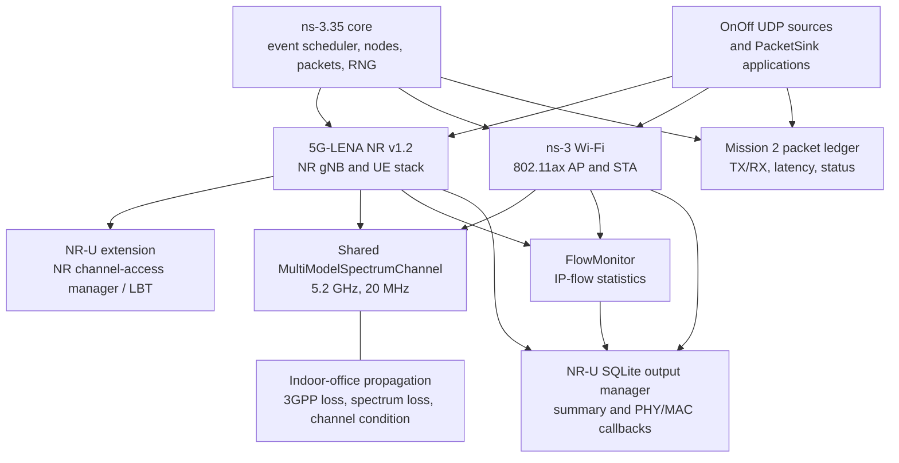

# Installed simulator architecture

## Implemented components

- **ns-3.35 core** supplies discrete-event scheduling, nodes, packets, callbacks, RNG streams, and simulation time. The project uses ns-3 Internet, mobility, propagation, spectrum, applications, FlowMonitor, Wi-Fi, and SQLite statistics modules.
- **5G-LENA NR v1.2** supplies NR gNB/UE devices, PHY/MAC, scheduler, bearer/RLC integration, and EPC-style connectivity used by `NrSingleBwpSetup` in the example.
- **NR-U extension** extends NR channel access for unlicensed operation. The example selects an NR channel access manager (CAM) for the gNB and installs NR-specific tracing/statistics callbacks.
- **ns-3 Wi-Fi** supplies the AP and STA devices. The example selects `WIFI_STANDARD_80211ax_5GHZ` by default and uses `SpectrumWifiPhy`, `ApWifiMac`, and `StaWifiMac`.
- **Spectrum and propagation** are shared: the example creates one `MultiModelSpectrumChannel`, connects a 3GPP indoor-office propagation model, a 3GPP spectrum propagation model, and a channel-condition model, then passes these objects to both the NR and Wi-Fi setup classes. Frequency is 5.2 GHz and bandwidth is 20 MHz.
- **Applications** are `OnOffApplication` UDP sources at one remote host and `PacketSink` receivers at the access-side UE/STA nodes. FlowMonitor collects IP-flow statistics; `SqliteOutputManager` stores summarized E2E values and instrumentation samples. Mission 2 adds independent app trace callbacks writing raw per-packet CSV.

### Research architecture diagram

The shared channel and propagation objects let the PHY models observe cross-technology RF activity; NR's channel access manager separately governs NR transmission eligibility. SQLite and CSV are complementary: SQLite remains the example's existing summary/instrumentation store, while CSV contains application packet records.

## Default topology

The default scenario has one NR gNB/UE pair and one Wi-Fi AP/STA pair, with a remote host acting as UDP source. Scenario placement is defined by `SinglePairNodeScenario`; the two access pairs are separate node indices at the configured positions. They use the same spectrum-channel object and indoor-office channel models. This is a simulation topology, not an assertion that the simulated NR and Wi-Fi nodes share a physical chassis or that this matches a particular deployment.

The default radio values from `cttc-nr-wifi-interference.cc` are 5.2 GHz, 20 MHz, NR numerology 0, 4 dBm total gNB/AP transmit power, 2 dBm NR UE transmit power, 5 m UE distance, and Wi-Fi CCA energy thresholds of -62 dBm. These are code defaults, not values validated as a universal deployment profile.

## Source map

- `source/ns-3-dev/contrib/nr-u/examples/cttc-nr-wifi-interference.cc`: scenario orchestration, parameters, applications, FlowMonitor, SQLite and latency callbacks.
- `source/ns-3-dev/contrib/nr-u/examples/nr-single-bwp-setup.cc` and related setup files: NR devices and channel-access manager wiring.
- `source/ns-3-dev/contrib/nr-u/model/wifi-setup.cc`: Wi-Fi AP/STA, spectrum PHY, CCA, station/AP traces, and channel request instrumentation.
- `source/ns-3-dev/contrib/nr-u/model/sqlite-output-manager.cc`: SQLite schema writes.
- `source/ns-3-dev/src/applications/model/onoff-application.cc` and `packet-sink.cc`: sequence/timestamp trace behavior.

## Boundaries and caveats

The model is discrete-event software with implementation assumptions. Propagation and interference outcomes depend on configured model objects, device placement, PHY/MAC settings, and simulator implementation. A shared channel does not by itself establish protocol compliance or calibration against hardware. For all claims distinguish: source code support, executed configuration, measured output, and standards/real-world validity.
