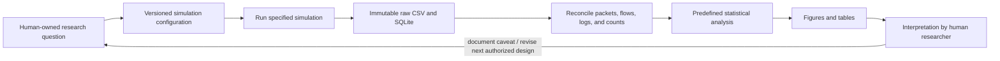
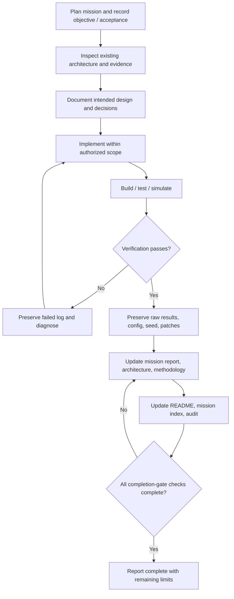

# Mission 2.5 — Comprehensive research documentation and governance

**Status:** Complete for the current verified environment and Missions 1/2 evidence. This mission changes documentation only; no simulator source, protocol behavior, build, or experiment was changed/run for this mission.

## Objective and acceptance criteria

Create a navigable, technically specific Markdown documentation system and root `AGENTS.md` that requires future missions to document objectives, architecture, decisions, changes, experiments, evidence, limitations, reproduction, diagrams, and completion status. Acceptance requires root README, architecture/methodology documentation, Mission 1/2 reports, Mermaid diagrams, decision records, reusable template, and an audit identifying unverified details.

## Research workflow diagram

The workflow keeps raw measurements, validation, derived analysis, and human interpretation separate. The loop does not authorize changing the question or launching another campaign without researcher direction.

## Mission execution and documentation lifecycle

The governance diagram is a required procedure, not a claim that all earlier missions were documented to this level when originally performed. In particular, Mission 2's first failed flow-matching run was overwritten by the later successful run; the limitation is disclosed in its report and audit.

## Delivered documentation system

- Root [`AGENTS.md`](../../AGENTS.md): permanent project operating rules and completion gate.
- Root [`README.md`](../../README.md): research overview, stack, reproduction, status, links.
- `docs/architecture/`: overall architecture, coexistence and packet flow, with architecture/topology/sequence diagrams.
- `docs/methodology/`: variables, traffic, statistical approach, latency formulas, validity risks.
- `docs/missions/`: individually navigable Mission 1, 2, and 2.5 reports and chronological index.
- `docs/decisions/`: backfilled ADR records with retrospective inference labeled.
- [`templates/MISSION-TEMPLATE.md`](../../templates/MISSION-TEMPLATE.md): mandatory reusable report format and checklist.
- [`docs/DOCUMENTATION-AUDIT.md`](../DOCUMENTATION-AUDIT.md): path, link, claim, number, Mermaid, and unresolved-evidence audit.

## Verification

Documentation claims were checked against `manifests/commits.txt`, source at the recorded commits plus local patches, saved configuration, run logs, CSV sidecar, analysis CSV, and preserved SQLite. No simulator rebuild or new simulation was necessary or performed. The Mission 1/2 report values and baseline counts were checked from files.

## Limitations

This documentation describes the installed legacy example and the one executed baseline; it does not validate NR-U conformance, real deployment behavior, all optional scenarios, load experiments, or statistical generalizability. Some installation-era dependency package versions were not captured. Mission 2's first failed endpoint-matching diagnostic was not separately retained after the log filename was reused; that failure record gap is explicitly disclosed.

## Completion gate

- [x] Documentation objective and acceptance criteria recorded.
- [x] Architecture, methodology, mission reports, ADRs, and five required Mermaid diagrams created.
- [x] Root index and chronological mission index updated.
- [x] Root AGENTS.md governance and reusable mission template established.
- [x] Local links and quantitative claims checked; audit written.
- [x] Unverified claims and the overwritten Mission 2 failure-log gaps disclosed.
- [x] No simulator build, new simulation, load sweep, or source/protocol modification performed for Mission 2.5.

## Git repository handoff

The subsequent GitHub handoff verified the authenticated owner and public `nru-publication` repository, inspected its existing `main` history, and based the in-place project repository on that initial commit without replacing workspace files. A source-excluding `.gitignore`, pinned-stack installer, staged-content audit, and reproducible patch validation are recorded in [`DOCUMENTATION-AUDIT.md`](../DOCUMENTATION-AUDIT.md). The root `AGENTS.md` now requires a documented commit and successful push to `main` after every future completed mission, absent an explicit human exception.
