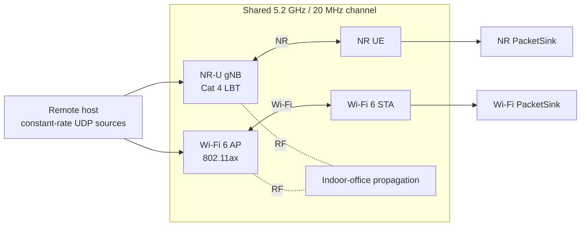
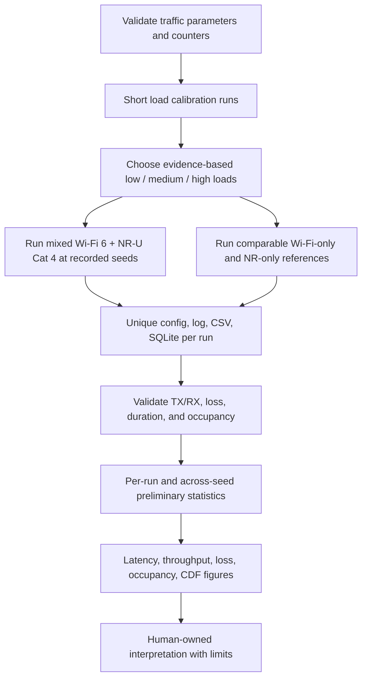

# Mission 3 — Controlled latency-under-load pilot

**Status:** COMPLETE — controlled pilot, references, analysis, validation, documentation, and publication completed. This remains a preliminary simulator pilot, not a full experimental campaign.

## 1. Objective and scope

- **Research objective:** Determine how increasing offered traffic load affects application-level latency, tail latency, throughput, and reliability when Wi-Fi 6 and 5G NR-U coexist in a shared unlicensed channel.
- **Mission objective:** Calibrate a small set of load levels, then run controlled replicated mixed-technology conditions plus comparable single-technology references.
- **In scope:** Fixed Wi-Fi 802.11ax, NR Cat 4 gNB LBT, fixed scenario 0/topology/5.2 GHz/20 MHz/propagation/power/packet size; independent random seeds; per-packet latency CSV and existing SQLite outputs; preliminary analysis and limitations.
- **Out of scope:** Cat 2/Cat 3 comparison, mobility, full publication campaign, protocol behavior changes, standards compliance claims, and real-world validation.
- **Scientific rationale:** Configured load may exceed achieved service capacity, changing queueing, access contention, loss, and latency. A calibrated pilot can establish whether the current setup produces measurable load response before a larger campaign.
- **Exploratory expectation only (not a researcher-registered hypothesis):** higher offered rate may increase delay, loss, occupancy, or throughput saturation; technology responses may differ. These are questions to evaluate, not assumed findings or causal claims.
- **Acceptance criteria:** traffic validation distinguishes configured/source-generated/received traffic; diagnostic calibration is evidence-based; at least three seeds per selected load; single-RAT references where practical; each run has unique configuration/log/CSV/SQLite; analysis includes per-technology counts and all requested metrics/figures; conclusions are caveated; documentation/index/audit updated; staged contents audited; commit pushed normally to `main`.

## 2. Existing architecture and affected components

The default official scenario sends downlink UDP from a remote host to an NR UE and Wi-Fi STA over shared 5.2 GHz/20 MHz spectrum with indoor-office propagation. `OnOffApplication::SetConstantRate` uses 1000-byte configured packets; `PacketSink` receives them. Mission 2 traces OnOff TX and PacketSink RX into per-packet CSV. `FlowMonitor` supplies IP-level TX/RX/throughput summaries; SQLite stores example statistics and channel-access callbacks. Sources/revisions: [architecture](../architecture/simulator.md), [packet flow](../architecture/packet-flow.md), [`manifests/commits.txt`](../../manifests/commits.txt).

Mission 3 added an optional traffic-generator stop time so sinks remain active during drain. PHY/MAC protocol behavior and radio parameters were not changed. The source diff is preserved as a patch; run orchestration and analysis scripts keep each execution separate.

## 3. Requirements and assumptions

- Keep Wi-Fi 802.11ax, NR gNB Cat 4 LBT, 5.2 GHz, 20 MHz, topology, propagation, transmit powers, packet size, and error/RLC settings fixed.
- Treat `nodeRate` as configured offered application rate. Record actual OnOff TX packet/byte counts and received bytes/throughput separately.
- Use an explicitly recorded, distinct ns-3 seed schedule per condition; record run IDs and RNG settings.
- Use sufficient active traffic and a post-source drain interval. If current implementation cannot do this safely, implement a narrowly scoped option and validate it against baseline behavior.
- Single-RAT references should use the same load/time/seed settings where possible, with only the access technology disabled.
- No unverified assumptions about what constitutes saturation or stable tails; use calibration output and state limitations.

## 4. Implementation details and decisions

The example gained one option, `trafficStopTime`, whose default resolves to `simTime`. Source apps stop at this value; PacketSinks and simulator remain active until `simTime`. SQLite IP throughput divides received bytes by the active source interval; occupancy remains normalized by the example's measurement window. Default behavior was regression-checked against the saved Mission 1 SQLite baseline and matched exactly. This source control does not change protocol logic. The 4.9 s horizon avoids the observed NR UE negative-delay assertion beyond that time; it does not resolve the scheduler issue. Patch: [`mission3-traffic-drain.patch`](../../patches/mission3-traffic-drain.patch).

Calibration-selected conditions are 500 kbps (Mission 1/2 baseline rate), 2 Mbps (intermediate), and 12 Mbps (highest tested rate that completed), each per enabled technology. Calibration did not establish saturation. See [D-006](../decisions/D-006-mission3-load-and-drain.md). A longer 7.5 s execution failed at 5.018928564 s in `NrUePhy::EndVarTti` when a negative next-TTI scheduling delay was requested. The log and gdb stack are retained; no PHY workaround was attempted. A 4.9 s horizon completed at the same seed/load. Pilot source traffic starts at 0.5 s and stops at 4.0 s, with sinks/simulation ending at 4.9 s (3.5 s active, 0.9 s drain). Seeds: 10 at 500 kbps (11–20), 5 at 2 Mbps (11–15), 3 at 12 Mbps (11/22/33). Matched Wi-Fi-only and NR-U-only references use 2 Mbps and seeds 11/22/33. The initial short-horizon pilot and calibration remain separately stored and are not pooled into final figures.

### Fixed parameters

| Parameter | Value |
|---|---|
| Scenario/topology | Scenario 0; one NR UE and Wi-Fi STA; remote UDP source endpoints |
| Node positions | gNB/AP reference `(0, 0, 1.5 m)`; UE/STA `(5, 0, 1.5 m)`; constant position |
| Wi-Fi / NR-U access | IEEE 802.11ax at 5 GHz / NR gNB Cat 4 LBT; NR UE always-on |
| Spectrum | 5.2 GHz center frequency, 20 MHz bandwidth, shared channel |
| Traffic | Downlink UDP; 1000-byte packets; one source per enabled technology |
| Timing | app start 0.5 s; traffic stop 4.0 s; simulation stop 4.9 s |
| Active / drain | 3.5 s / 0.9 s |
| Propagation | 3GPP indoor office mixed; fixed scenario 0 positions |
| Tx power | total 4 dBm; NR UE 2 dBm |
| NR PHY/RLC | `NrEesmIrT1`; `RlcUmAlways` |
| Loads and seed counts | 0.5 Mbps: seeds 11–20; 2 Mbps: 11–15; 12 Mbps: 11, 22, 33 |
| Deadline thresholds | 500, 1000, 5000 µs; analysis CLI-configurable |

The machine-readable record is [`configs/mission3-pilot.json`](../../configs/mission3-pilot.json); each run folder stores all effective arguments, seed/run, status, and artifact names.

## 5. Architecture / experiment diagrams

### Fixed network topology (Mission 1/2 implementation; run configuration fixed for Mission 3)



This is source-grounded in the official example helper wiring. The diagram is not a new topology or a claim of hardware equivalence.

### Pilot workflow



## 6. Changed files and reproducible patches

| Path | Change and purpose | Evidence/patch |
|---|---|---|
| `source/ns-3-dev/contrib/nr-u/examples/cttc-nr-wifi-interference.cc` | Added optional `trafficStopTime`; default still maps to `simTime`, enabling a packet drain interval. | Incremental [`mission3-traffic-drain.patch`](../../patches/mission3-traffic-drain.patch), applied with `git apply --unidiff-zero` atop Mission 2; `logs/build-mission3-traffic-stop.log` |
| `scripts/run_mission3.py` | Records exact command/config and uses unique run folders; refuses to overwrite. | per-run JSON/log/CSV/SQLite |
| `scripts/analyze_mission3.py` | Validates measurements and generates seed/condition metrics and figures; deadline thresholds configurable. | `results/mission3/analysis/` |
| `configs/mission3-pilot.json` | Records common settings, loads, seed schedule, references, and percentile gate. | this JSON |
| Mission/methodology/decision docs | Captures design, evidence, analysis, rationale, limitations, next step. | linked in Sections 7–10 and D-006 |

## 7. Dependencies, configuration, and reproduction

Pinned stack is in `manifests/commits.txt`; configuration is in [`configs/mission3-pilot.json`](../../configs/mission3-pilot.json). From the project root with the existing Mission 1 build:

```sh
python3 scripts/run_mission3.py --phase pilot-revised --rates 500kbps --seeds 11,12,13,14,15,16,17,18,19,20 --modes mixed --active-seconds 3.5 --drain-seconds 0.9 --start-seconds 0.5
python3 scripts/run_mission3.py --phase pilot-revised --rates 2Mbps --seeds 11,12,13,14,15 --modes mixed --active-seconds 3.5 --drain-seconds 0.9 --start-seconds 0.5
python3 scripts/run_mission3.py --phase pilot-revised --rates 12Mbps --seeds 11,22,33 --modes mixed --active-seconds 3.5 --drain-seconds 0.9 --start-seconds 0.5
python3 scripts/run_mission3.py --phase reference --rates 2Mbps --seeds 11,22,33 --modes wifi-only,nr-only --active-seconds 3.5 --drain-seconds 0.9 --start-seconds 0.5
python3 scripts/analyze_mission3.py --deadlines-us 500,1000,5000
```

The run script refuses to overwrite an existing output directory; these commands reproduce in a clean checkout. It invokes the existing compiled binary directly and sets its library path. Python, NumPy, and Matplotlib are required for analysis. Matplotlib printed a nonfatal warning about optional 3D axes from multiple installed versions; all 2D figures were created.

## 8. Verification and tests

The incremental build succeeded (`logs/build-mission3-traffic-stop.log`). Default stopping behavior was regression-checked against Mission 1 SQLite E2E rows; throughput, bytes, mean latency, and jitter matched. The analysis inspected 39 run directories: 35 completed and four failed calibration/initial-pilot attempts. All 24 primary revised mixed/reference runs exited 0. Those primary runs contain 49,838 TX records and 49,838 unique RX records; all had zero not-received-by-stop, duplicate, or unmatched packets. Per-run sidecar counts reconcile with CSV records; CSV key uniqueness, timestamps/status, and SQLite schema were checked. Both Python scripts passed syntax compilation. Five figures and summary CSVs were generated. Failed run configs/logs are preserved and indexed in [`failed-runs.csv`](../../results/mission3/analysis/failed-runs.csv).

## 9. Raw data and result references

Unique raw run folders are retained locally under `results/mission3/{calibration,pilot,pilot-revised,reference,diagnostics}/`, with original CSV, SQLite, execution log, effective JSON config, and validation sidecar. Raw run directories are gitignored to avoid publishing full generated datasets. Compact analysis outputs are [`condition-summary.csv`](../../results/mission3/analysis/condition-summary.csv), [`seed-run-metrics.csv`](../../results/mission3/analysis/seed-run-metrics.csv), [`failed-runs.csv`](../../results/mission3/analysis/failed-runs.csv), and the five PNGs alongside them. Derived outputs can be recreated from raw runs without modifying them.

## 10. Analysis and interpretation

Primary mixed pilot conditions were 10 seeds at 500 kbps, 5 at 2 Mbps, and 3 at 12 Mbps. Each condition's NR and Wi-Fi flow respectively transmitted and uniquely received 2,180, 4,370, and 15,747 packets. All 24 primary mixed and single-RAT reference runs had zero nonreceipt-by-stop, duplicate, or unmatched packets. Nonreceipt is an observation at stop, not a known-drop label.

| Rate per technology | Tech | TX-derived source rate Mbps | RX app payload Mbps | FlowMonitor IP RX Mbps | Occupancy | Mean latency µs (95% across-seed CI) | Median / P95 / P99 µs | P99.9 µs (pooled received n) | Mean abs. successive-delay variation µs | Nonreceipt | Miss ratio >500 / >1000 / >5000 µs |
|---:|---|---:|---:|---:|---:|---:|---|---:|---:|---:|---|
| 0.5 Mbps | NR | 0.4983 | 0.4983 | 0.5122 | 0.03508 | 3339.2 (3329.6–3348.8) | 3314.3 / 3314.3 / 3514.3 | not reported (n=2180) | 30.5 | 0/2180 | 1.000 / 1.000 / 0.00459 |
| 0.5 Mbps | Wi-Fi | 0.4983 | 0.4983 | 0.5122 | 0.01113 | 174.4 (168.0–180.8) | 134.8 / 351.5 / 387.4 | not reported (n=2180) | 76.6 | 0/2180 | 0.00459 / 0 / 0 |
| 2 Mbps | NR | 1.9977 | 1.9977 | 2.0537 | 0.08366 | 4326.9 (4279.4–4374.4) | 4314.3 / 4314.3 / 5522.7 | not reported (n=4370) | 89.0 | 0/4370 | 1.000 / 1.000 / 0.01762 |
| 2 Mbps | Wi-Fi | 1.9977 | 1.9977 | 2.0537 | 0.03474 | 446.9 (437.9–455.9) | 453.4 / 519.1 / 526.0 | not reported (n=4370) | 62.0 | 0/4370 | 0.16018 / 0.00114 / 0 |
| 12 Mbps | NR | 11.9977 | 11.9977 | 12.3337 | 0.20534 | 5460.6 (identical observed seed means) | 5456.3 / 6123.5 / 6123.8 | 7290.5 (n=15,747) | 889.3 | 0/15747 | 1.000 / 1.000 / 0.66737 |
| 12 Mbps | Wi-Fi | 11.9977 | 11.9977 | 12.3337 | 0.18447 | 180.5 (165.5–195.5) | 154.3 / 294.8 / 325.3 | 1076.3 (n=15,747) | 85.4 | 0/15747 | 0.00464 / 0.00159 / 0 |

TX-derived source rate is TX packet count × 1000 bytes × 8 / 3.5 s; received app payload rate uses RX count with that same packet size and active interval. FlowMonitor counts IP-layer bytes, explaining its larger reported throughput. All primary packets were received, so source rate and application payload rate agree. Deadline ratios conservatively count any packet not received by simulation stop as a violation; none occurred. The reported 95% intervals are Student-t intervals over run-level mean latency, not packet-level intervals. The high-load NR run means were numerically identical, yielding a degenerate interval; this observed zero variation is not evidence of zero uncertainty.

Matched 2 Mbps references: NR-only mean latency 4309.9 µs (95% seed CI 4308.3–4311.6), occupancy 0.08323; Wi-Fi-only mean 130.6 µs (127.6–133.6), occupancy 0.03349. Both references had 2,622/2,622 unique receptions over three seeds. Mixed NR mean latency (4326.9 µs) was close to NR-only; mixed Wi-Fi mean (446.9 µs) exceeded Wi-Fi-only (130.6 µs). This is a descriptive comparison, not causal evidence.

NR mean latency increased across the selected rates (3.34, 4.33, 5.46 ms), while its channel-occupancy ratio rose (0.035, 0.084, 0.205). The co-movement is compatible with more channel activity but does not show that occupancy caused the latency change. Wi-Fi mean latency was nonmonotonic (0.174, 0.447, 0.181 ms) despite rising occupancy. At 12 Mbps, Wi-Fi P99.9 (1.076 ms) was well above P99 (0.325 ms), revealing a sparse tail hidden by its mean. No completed primary condition showed nonreceipt. Occupancy near 20% does not establish congestion or saturation. Available results do not attribute delay to retransmission or a measured MAC access wait.

Figures: [mean/P99 latency vs load](../../results/mission3/analysis/latency-vs-offered-load.png), [payload throughput/nonreceipt/occupancy](../../results/mission3/analysis/throughput-loss-occupancy-vs-load.png), [received-packet ECDF](../../results/mission3/analysis/latency-ecdf-by-load.png), [seed-level variation](../../results/mission3/analysis/seed-variation.png), and [mixed/reference comparison](../../results/mission3/analysis/mixed-vs-single-technology.png). Load-figure error bars show ±1 run-level standard deviation, not confidence intervals; the seed-level figure shows individual run means. ECDFs condition on received packets.

## 11. Limitations and uncertainties

Known risks include the observed negative-delay scheduler assertion beyond this horizon, short duration without validated warm-up/steady state, differences between offered/source/app/IP throughput measures, received-only latency quantiles, stop-time censoring, unequal seed counts, and no real-device validation. The high-load NR run-level mean was exactly identical across seeds for an unverified reason. P99.9 is based on 15,747 pooled samples (about 16 observations in the upper 0.1%) and remains exploratory. There is no retransmission attribution, per-attempt MAC access-delay measure, fairness statistic, or evidence of saturation. See [measurement validity](../methodology/measurement-validity.md).

## 12. Problems encountered and resolutions

Four executions failed and are retained with full logs/configs: 14, 16, and 20 Mbps calibration runs, plus the initial 2 Mbps/seed 11 run at 7.5 s. Each terminated with `DefaultSimulatorImpl::Schedule(): Negative delay`; gdb identifies `NrUePhy::EndVarTti` at `nr-ue-phy.cc:992`. The horizon was capped at 4.9 s and the same 2 Mbps/seed 11 condition then completed. No protocol workaround was attempted. The 12 Mbps runs required about four minutes wall time per run on this host. Matplotlib emitted a nonfatal optional Axes3D import warning; required 2D figures were produced.

## 13. Decisions made

D-006 records the drain-time implementation and calibration-selected rates. Final figures use only common-horizon `pilot-revised` runs; calibration and early short-horizon runs are not mixed into those comparisons.

## 14. Final deliverables

The deliverables include the successful incremental build and default-behavior regression, 24 successful primary mixed/reference runs, all local raw evidence, analysis scripts and outputs, a reproducible source patch, and updated methodology, D-006, README/index/audit. Mission implementation commit [`9c50423`](https://github.com/kirolossedra/nru-publication/commit/9c50423bf8866b4180284e0026602e6851d8efc5) was pushed normally to `main`; the audit records the remote SHA and published file list.

## 15. Unresolved questions / next step

Recommended next mission: investigate and resolve or characterize the NR UE negative-delay scheduler limitation through a separately reviewed, protocol-preserving change; add MAC attempt/defer/backoff, retransmission, and PHY/MAC drop instrumentation; then justify warm-up and longer observation horizons. Before a larger campaign, predefine a balanced seed/load design that reaches an empirically justified service limit. Any access-mechanism or protocol behavior change needs its own decision and verification.

## 16. Documentation completion checklist

- [x] Acceptance criteria addressed; failed runs are evidenced.
- [x] Build, regression check, simulations and logs completed.
- [x] Raw outputs, configurations, seeds, versions and commands documented.
- [x] Source change has a reproducible patch.
- [x] Methodology and existing topology/workflow diagrams are linked and updated.
- [x] Mission history and root README updated.
- [x] Documentation audit, links, numerics and staged artifacts checked.
- [x] Limitations and unresolved issues disclosed.
- [x] No prior raw result overwritten or deleted.
- [x] Commit pushed normally to `main`; details recorded in the audit.
